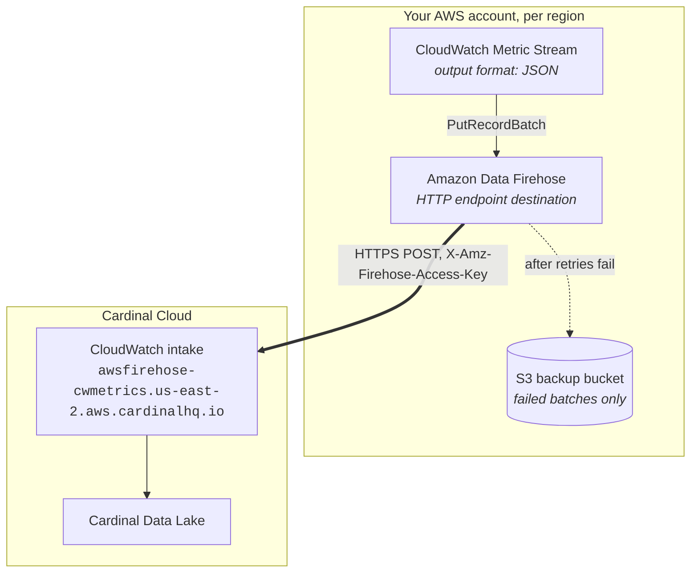

import SupportCallout from '../../components/SupportCallout';
import { Prerequisites, Steps, Step, NextSteps } from '../../components/HowTo';

# Streaming CloudWatch Metrics to Cardinal Cloud

This guide streams AWS CloudWatch metrics into Cardinal Cloud (SaaS) over HTTPS. A CloudWatch **Metric Stream** writes to an **Amazon Data Firehose** stream, and Firehose POSTs each batch to Cardinal's CloudWatch intake endpoint. Nothing runs in your account except the two AWS-managed streams: no collector, no polling agent, no per-metric `GetMetricData` charges.

The moving parts are the metric stream, the Firehose stream, and your organization ingest API key. Around them you provision what Firehose itself requires: an S3 bucket that receives only failed batches, two IAM roles, and a CloudWatch Logs group for delivery errors. The guide shows every step in the AWS console first, then the same setup as Terraform.

> **Which path is this?** Cardinal can also read Metric Streams that Firehose delivers to **your own S3 bucket**, which is the path for self-hosted Cardinal Data Lake and customer-account deployments. That path is described in the blog post [Getting CloudWatch Metrics into Cardinal Data Lake](https://cardinalhq.io/blog/cloudwatch-metrics-to-cardinal). This page covers the **HTTP endpoint** path: Firehose sends metrics directly to Cardinal, so there is no bucket notification, ingest queue, or prefix mapping to configure, and the only bucket on your side holds failed batches. This is the right choice for Cardinal Cloud.

<Prerequisites
  items={[
    {
      icon: '🔑',
      title: 'Organization ingest API key',
      alt: <>Before starting, obtain your organization's <strong>ingest API key</strong> from Cardinal support. This is the key that authenticates telemetry sent to Cardinal; it is not the Query API Key or an admin credential.</>,
    },
    {
      icon: '☁',
      title: 'AWS permissions',
      alt: <>Rights to create a Firehose stream, a CloudWatch metric stream, two IAM roles, and one S3 bucket (Firehose's required backup location) in each account and region you want to stream from.</>,
    },
    {
      icon: '↔',
      title: 'Outbound HTTPS',
      alt: <>Firehose connects to <code>awsfirehose-cwmetrics.us-east-2.aws.cardinalhq.io</code> on port 443. Firehose is AWS-managed, so no VPC or firewall change is needed.</>,
    },
  ]}
/>

## How it works



| Setting | Value |
|---|---|
| Endpoint URL | `https://awsfirehose-cwmetrics.us-east-2.aws.cardinalhq.io` |
| Authentication | Your organization ingest API key, sent by Firehose as the `X-Amz-Firehose-Access-Key` header (the Firehose **Access key** field) |
| Payload | CloudWatch Metric Streams **JSON** output format |
| Content encoding | GZIP (recommended) or none |
| Delivery | At least once. Firehose retries any non-2xx response for the configured retry duration, then writes the failed batch to your backup bucket |

Cardinal identifies your organization from the API key alone. Every metric stream in every AWS account and region that uses that key lands in the same Cardinal organization; the records themselves carry `account_id` and `region`, which become the `cloud_account_id` and `cloud_region` attributes.

The endpoint is hosted in `us-east-2`, but it is a plain HTTPS URL. A Firehose stream in any AWS region can deliver to it. Metric Streams are regional, so you create one metric stream and one Firehose stream per region you want to monitor.

## Setup in the AWS console

Firehose requires an S3 bucket for HTTP endpoint destinations, used for batches that Cardinal could not accept. Create or pick a bucket before you start; it stays empty in normal operation.

<Steps>

<Step title="Have your organization ingest API key ready">

Request the key from Cardinal support if you do not have it yet. It is the same kind of key an OpenTelemetry collector uses to send telemetry to your Cardinal organization.

Treat this key like a password. Anyone holding it can write metrics into your organization. The Firehose console stores it as a secret and never shows it again after creation.

</Step>

<Step title="Create the Firehose stream">

Open the **Amazon Data Firehose** console in the region whose metrics you want, and click **Create Firehose stream**.

1. **Source:** `Direct PUT`.
2. **Destination:** `HTTP Endpoint`.
3. **Firehose stream name:** `cardinal-cwmetrics` (any name works; this guide uses it throughout).
4. Under **Destination settings**:
   - **HTTP endpoint name:** `Cardinal`
   - **HTTP endpoint URL:** `https://awsfirehose-cwmetrics.us-east-2.aws.cardinalhq.io`
   - **Access key:** paste your organization ingest API key
   - **Content encoding:** `GZIP`
   - **Retry duration:** `300` seconds (the default). Keep it at least 60; a short retry window sends transient failures to the backup bucket instead of retrying.
   - **Parameters:** add key `cardinalhq.format` with value `cwmetrics`. This is optional today, since `cwmetrics` is the default, but it makes the stream's purpose explicit.
5. Under **Buffer hints**:
   - **Buffer size:** `5` MiB
   - **Buffer interval:** `60` seconds
   Firehose flushes when either limit is reached. A 60-second interval gives metrics close to the freshness CloudWatch itself offers; a longer interval sends fewer, larger requests. Keep the buffer size at or below 48 MiB: Firehose base64-encodes records into the request body, which grows it by about a third, and Cardinal rejects bodies over 64 MiB.
6. Under **Backup settings**:
   - **Source record backup in Amazon S3:** `Failed data only`
   - **S3 backup bucket:** your backup bucket
   - **S3 backup bucket error output prefix:** `cardinal-cwmetrics-errors/` (optional, keeps failures easy to find)
7. Under **Advanced settings**, leave **Amazon CloudWatch error logging** enabled. Firehose writes Cardinal's rejection reasons there, which is where you look if nothing arrives.
8. Let the console create a new **IAM role** for the stream, or pick an existing one that can write to the backup bucket and to CloudWatch Logs.
9. Click **Create Firehose stream** and wait for the status to become **Active**.

</Step>

<Step title="Create the CloudWatch metric stream">

Open the **CloudWatch** console in the same region, go to **Metrics → Streams**, and click **Create metric stream**.

1. **Metrics to be streamed:** choose **Select metrics** and pick the namespaces you want, such as `AWS/EC2`, `AWS/RDS`, `AWS/ApplicationELB`, `AWS/Lambda`, `AWS/SQS`, and `AWS/ECS`. Choosing **All metrics** also works; add `AWS/Usage` and other high-cardinality namespaces to the **exclude** list to control cost.
2. **Configuration:** choose **Custom setup with Firehose**, then **Select your Firehose stream** and pick `cardinal-cwmetrics`.
3. **Service role:** let the console create a new role, or pick one that allows `firehose:PutRecord` and `firehose:PutRecordBatch` on that stream.
4. **Change output format:** choose **JSON**. This matters: Cardinal accepts the Metric Streams JSON format and rejects the OpenTelemetry 0.7 and 1.0 formats with a `400` that names the problem.
5. **Metric stream name:** `cardinal-cwmetrics`.
6. Click **Create metric stream**.

CloudWatch starts streaming within a couple of minutes.

</Step>

<Step title="Verify delivery">

In the **Firehose** console, open the stream's **Monitoring** tab. Within five minutes you should see:

- `Incoming records` rising, which means CloudWatch is sending.
- `Delivery to HTTP endpoint success` at `1`, which means Cardinal is accepting every request.

In Cardinal Cloud, open **Explore → Metrics** and search for a metric from a namespace you streamed. Names are the CloudWatch namespace and metric name, lowercased, joined with `_`:

| CloudWatch | Cardinal metric |
|---|---|
| `AWS/EC2` / `CPUUtilization` | `aws_ec2_cpuutilization` |
| `AWS/RDS` / `DatabaseConnections` | `aws_rds_databaseconnections` |
| `AWS/ApplicationELB` / `TargetResponseTime` | `aws_applicationelb_targetresponsetime` |

Filter by `cloud_account_id`, `cloud_region`, `aws_namespace`, or any CloudWatch dimension such as `instanceid`.

</Step>

<Step title="Repeat per region and account">

Metric streams are regional. For each additional region, repeat the Firehose and metric stream steps in that region with the same API key. For additional AWS accounts, do the same in each account. Everything lands in one Cardinal organization, separated by the `cloud_account_id` and `cloud_region` attributes.

</Step>

</Steps>

## Setup with Terraform

The module below creates everything the console steps create: the backup bucket, both IAM roles, the Firehose stream with the Cardinal HTTP endpoint, and the metric stream. Apply it once per region per account, with a provider aliased to that region.

Requires the AWS provider v6.0 or later (validated with v6.69.1). On v5 providers, use `data.aws_region.current.name` in place of `.region`.

```hcl copy
terraform {
  required_providers {
    aws = {
      source  = "hashicorp/aws"
      version = ">= 6.0"
    }
  }
}

variable "cardinal_api_key_secret_arn" {
  description = "ARN of a Secrets Manager secret holding {\"api_key\": \"<Cardinal organization ingest API key>\"}, in this region"
  type        = string
}

variable "name" {
  description = "Base name for all resources"
  type        = string
  default     = "cardinal-cwmetrics"
}

variable "include_namespaces" {
  description = "CloudWatch namespaces to stream. Empty streams everything except exclude_namespaces."
  type        = list(string)
  default     = ["AWS/EC2", "AWS/RDS", "AWS/ApplicationELB", "AWS/Lambda", "AWS/SQS", "AWS/ECS"]
}

variable "exclude_namespaces" {
  description = "Namespaces never to stream. Only used when include_namespaces is empty."
  type        = list(string)
  default     = ["AWS/Usage"]
}

locals {
  cardinal_endpoint = "https://awsfirehose-cwmetrics.us-east-2.aws.cardinalhq.io"
}

data "aws_caller_identity" "current" {}
data "aws_region" "current" {}

# IAM role names are account-global, so qualify them with the region. This lets
# the same module be applied once per region without role-name collisions.
locals {
  role_prefix = "${var.name}-${data.aws_region.current.region}"
}

# ---------------------------------------------------------------------------
# Backup bucket. Firehose requires one for HTTP endpoint destinations; it only
# receives batches Cardinal rejected after retries, so it stays empty normally.
# ---------------------------------------------------------------------------
resource "aws_s3_bucket" "backup" {
  bucket_prefix = "${var.name}-backup-"
}

resource "aws_s3_bucket_public_access_block" "backup" {
  bucket                  = aws_s3_bucket.backup.id
  block_public_acls       = true
  block_public_policy     = true
  ignore_public_acls      = true
  restrict_public_buckets = true
}

resource "aws_s3_bucket_lifecycle_configuration" "backup" {
  bucket = aws_s3_bucket.backup.id

  rule {
    id     = "expire-failed-batches"
    status = "Enabled"
    filter {}
    expiration {
      days = 14
    }
  }
}

# ---------------------------------------------------------------------------
# Firehose delivery role: write failures to the backup bucket, log errors.
# ---------------------------------------------------------------------------
resource "aws_cloudwatch_log_group" "firehose" {
  name              = "/aws/kinesisfirehose/${var.name}"
  retention_in_days = 14
}

resource "aws_cloudwatch_log_stream" "firehose" {
  name           = "HttpEndpointDelivery"
  log_group_name = aws_cloudwatch_log_group.firehose.name
}

data "aws_iam_policy_document" "firehose_assume" {
  statement {
    actions = ["sts:AssumeRole"]
    principals {
      type        = "Service"
      identifiers = ["firehose.amazonaws.com"]
    }
    condition {
      test     = "StringEquals"
      variable = "sts:ExternalId"
      values   = [data.aws_caller_identity.current.account_id]
    }
  }
}

resource "aws_iam_role" "firehose" {
  name               = "${local.role_prefix}-firehose"
  assume_role_policy = data.aws_iam_policy_document.firehose_assume.json
}

data "aws_iam_policy_document" "firehose" {
  statement {
    sid = "BackupBucket"
    actions = [
      "s3:AbortMultipartUpload",
      "s3:GetBucketLocation",
      "s3:GetObject",
      "s3:ListBucket",
      "s3:ListBucketMultipartUploads",
      "s3:PutObject",
    ]
    resources = [
      aws_s3_bucket.backup.arn,
      "${aws_s3_bucket.backup.arn}/*",
    ]
  }

  statement {
    sid       = "ErrorLogs"
    actions   = ["logs:PutLogEvents"]
    resources = ["${aws_cloudwatch_log_group.firehose.arn}:*"]
  }

  # Firehose reads the Cardinal API key from Secrets Manager at delivery time.
  # Add kms:Decrypt on the key if the secret uses a customer-managed KMS key.
  statement {
    sid       = "ReadCardinalApiKey"
    actions   = ["secretsmanager:GetSecretValue"]
    resources = [var.cardinal_api_key_secret_arn]
  }
}

resource "aws_iam_role_policy" "firehose" {
  name   = "${var.name}-firehose"
  role   = aws_iam_role.firehose.id
  policy = data.aws_iam_policy_document.firehose.json
}

# ---------------------------------------------------------------------------
# Firehose stream: HTTP endpoint destination pointed at Cardinal.
# ---------------------------------------------------------------------------
resource "aws_kinesis_firehose_delivery_stream" "cardinal" {
  name        = var.name
  destination = "http_endpoint"

  http_endpoint_configuration {
    name     = "Cardinal"
    url      = local.cardinal_endpoint
    role_arn = aws_iam_role.firehose.arn

    # Firehose fetches the API key from Secrets Manager, so it never enters
    # Terraform state. The secret must be in the same region as the stream.
    secrets_manager_configuration {
      enabled    = true
      secret_arn = var.cardinal_api_key_secret_arn
      role_arn   = aws_iam_role.firehose.arn
    }

    # Fallback for AWS provider versions that lack the block above: declare a
    # sensitive string variable and pass the key directly. It is then stored
    # in plaintext in Terraform state, so protect the state backend as you
    # would the key itself.
    # access_key = var.cardinal_api_key

    # Flush every 60 s or 5 MiB, whichever comes first. Keep buffering_size at
    # or below 48: Firehose base64-encodes records into the request body,
    # and Cardinal rejects bodies over 64 MiB with a permanent 413.
    buffering_interval = 60
    buffering_size     = 5

    # Retry non-2xx responses for 5 minutes before writing the batch to S3.
    retry_duration = 300
    s3_backup_mode = "FailedDataOnly"

    request_configuration {
      content_encoding = "GZIP"

      # Optional: cwmetrics is the default, but declaring it is explicit.
      common_attributes {
        name  = "cardinalhq.format"
        value = "cwmetrics"
      }
    }

    s3_configuration {
      role_arn            = aws_iam_role.firehose.arn
      bucket_arn          = aws_s3_bucket.backup.arn
      prefix              = "${var.name}/"
      error_output_prefix = "${var.name}-errors/"
      compression_format  = "GZIP"
    }

    cloudwatch_logging_options {
      enabled         = true
      log_group_name  = aws_cloudwatch_log_group.firehose.name
      log_stream_name = aws_cloudwatch_log_stream.firehose.name
    }
  }

  depends_on = [aws_iam_role_policy.firehose]
}

# ---------------------------------------------------------------------------
# Metric stream role: lets CloudWatch write into the Firehose stream.
# ---------------------------------------------------------------------------
data "aws_iam_policy_document" "metric_stream_assume" {
  statement {
    actions = ["sts:AssumeRole"]
    principals {
      type        = "Service"
      identifiers = ["streams.metrics.cloudwatch.amazonaws.com"]
    }
  }
}

resource "aws_iam_role" "metric_stream" {
  name               = "${local.role_prefix}-metric-stream"
  assume_role_policy = data.aws_iam_policy_document.metric_stream_assume.json
}

data "aws_iam_policy_document" "metric_stream" {
  statement {
    actions   = ["firehose:PutRecord", "firehose:PutRecordBatch"]
    resources = [aws_kinesis_firehose_delivery_stream.cardinal.arn]
  }
}

resource "aws_iam_role_policy" "metric_stream" {
  name   = "${var.name}-metric-stream"
  role   = aws_iam_role.metric_stream.id
  policy = data.aws_iam_policy_document.metric_stream.json
}

# ---------------------------------------------------------------------------
# Metric stream. Output format MUST be json; Cardinal rejects the
# OpenTelemetry formats.
# ---------------------------------------------------------------------------
resource "aws_cloudwatch_metric_stream" "cardinal" {
  name          = var.name
  role_arn      = aws_iam_role.metric_stream.arn
  firehose_arn  = aws_kinesis_firehose_delivery_stream.cardinal.arn
  output_format = "json"

  dynamic "include_filter" {
    for_each = var.include_namespaces
    content {
      namespace = include_filter.value
    }
  }

  dynamic "exclude_filter" {
    for_each = length(var.include_namespaces) == 0 ? var.exclude_namespaces : []
    content {
      namespace = exclude_filter.value
    }
  }

  depends_on = [aws_iam_role_policy.metric_stream]
}

output "firehose_stream_arn" {
  value = aws_kinesis_firehose_delivery_stream.cardinal.arn
}

output "metric_stream_arn" {
  value = aws_cloudwatch_metric_stream.cardinal.arn
}
```

The module never sees the API key itself. Store it in Secrets Manager first, in the same region as the stream, as a JSON object with an `api_key` field (the format Firehose requires for HTTP endpoint destinations), then pass the secret's ARN:

```bash copy
SECRET_ARN="$(aws secretsmanager create-secret \
  --region us-east-1 \
  --name cardinal/org-ingest-api-key \
  --secret-string '{"api_key":"<your Cardinal organization ingest API key>"}' \
  --query ARN --output text)"
terraform apply -var "cardinal_api_key_secret_arn=$SECRET_ARN"
```

If you must use the `access_key` fallback instead, the key is written to Terraform state in plaintext. Restrict read access to the state backend as you would to the key itself.

### Streaming several regions

Instantiate the configuration once per region with provider aliases. The module qualifies its IAM role names with the region, so the instances do not collide on account-global role names. Each region needs its own copy of the secret; [Secrets Manager replication](https://docs.aws.amazon.com/secretsmanager/latest/userguide/create-manage-multi-region-secrets.html) keeps one source of truth. Put the code above in a module directory, then:

```hcl copy
provider "aws" {
  alias  = "us_east_1"
  region = "us-east-1"
}

provider "aws" {
  alias  = "eu_west_1"
  region = "eu-west-1"
}

module "cardinal_cwmetrics_us_east_1" {
  source                      = "./modules/cardinal-cwmetrics"
  providers                   = { aws = aws.us_east_1 }
  cardinal_api_key_secret_arn = "arn:aws:secretsmanager:us-east-1:123456789012:secret:cardinal/org-ingest-api-key-AbCdEf"
}

module "cardinal_cwmetrics_eu_west_1" {
  source                      = "./modules/cardinal-cwmetrics"
  providers                   = { aws = aws.eu_west_1 }
  cardinal_api_key_secret_arn = "arn:aws:secretsmanager:eu-west-1:123456789012:secret:cardinal/org-ingest-api-key-AbCdEf"
}
```

Add `include_filter` blocks with `metric_names` if you want only specific metrics from a namespace rather than the whole namespace.

## What arrives in Cardinal

Each Metric Streams record is one datapoint carrying `{min, max, sum, count}` for a period. Cardinal stores those four statistics exactly as rollups, so counts, sums, averages, minimums, and maximums are correct and aggregate correctly across dimensions. CloudWatch does not send the individual samples, so percentiles cannot be recovered from a streamed metric.

| Record field | Cardinal |
|---|---|
| `namespace` + `metric_name` | metric name, e.g. `aws_elb_latency`, type `gauge` |
| each `dimensions` key | attribute, lowercased, e.g. `loadbalancername` |
| `account_id` | `cloud_account_id` |
| `region` | `cloud_region` |
| `namespace` | `aws_namespace` |
| `metric_stream_name` | `metric_stream_name` |
| `unit` | passed through verbatim (`Seconds`, `Count`, `Percent`) |

## Troubleshooting

Firehose reports every rejection in the stream's CloudWatch Logs group (`/aws/kinesisfirehose/<stream name>` when created by the console, or the group you configured) and in the **Monitoring** tab. Cardinal's response body carries an `errorMessage` that says why.

| Symptom | Cause | Fix |
|---|---|---|
| `Delivery to HTTP endpoint success` is `0` and the error log shows `401` with `invalid API key` | The **Access key** is not a valid organization ingest API key, or the organization is disabled | Console path: re-enter the key under the Firehose stream's **Destination settings**. Terraform path: update the Secrets Manager secret's value; Firehose refreshes its cached secret within 10 minutes. Cardinal accepts a newly issued key within a minute |
| Error log shows `400` with `record is not CloudWatch Metric Streams JSON` | The metric stream's output format is **OpenTelemetry 0.7** or **1.0**, or the Firehose source is a CloudWatch Logs subscription rather than a metric stream | Set the metric stream's output format to **JSON** |
| Error log shows `400` with `unsupported cardinalhq.format` | The `cardinalhq.format` parameter is set to something other than `cwmetrics` | Set it to `cwmetrics` or remove it |
| Error log shows `413` | A single request body exceeded 64 MiB. Base64 encoding makes the body about a third larger than the buffer, so a buffer size near Firehose's 64 MiB maximum always fails. Firehose treats this as permanent and writes the batch to the backup bucket | Lower the **Buffer size** to 48 MiB or less |
| Objects appearing in the backup bucket | Cardinal rejected a batch or was unreachable for longer than the retry duration | Read the error log for the reason. Backup objects are not re-sent automatically |
| `Incoming records` is `0` | The metric stream is not running, or its role cannot write to Firehose | Check the metric stream's status in CloudWatch → Metrics → Streams, and the role's `firehose:PutRecord` permission |
| Delivery succeeds but a namespace is missing in Cardinal | The namespace is not in the metric stream's include list, or is in its exclude list | Edit the metric stream's filters. Changes take effect within minutes |
| Metrics arrive several minutes late | CloudWatch publishes many service metrics minutes after the fact, and Firehose buffers up to the configured interval | Expected. Lowering the buffer interval below 60 s changes little, because CloudWatch's own publication delay dominates |

Delivery is at least once. If Firehose retries a batch that Cardinal already stored, the retry is deduplicated for about an hour; a much later retry is ingested again, which can double-count that batch's datapoints for the affected minute.

## Cost notes

- **CloudWatch** bills per metric update sent to the stream. Include only the namespaces you query, and exclude `AWS/Usage`.
- **Firehose** bills per GiB ingested. GZIP content encoding does not change the Firehose charge (it is billed before compression) but shrinks the transfer.
- **S3** charges for the backup bucket are negligible unless deliveries fail; the lifecycle rule above expires failed batches after 14 days.
- There is no `GetMetricData` polling and no agent fleet to run.

<NextSteps
  items={[
    {
      icon: '📊',
      title: 'Explore metrics',
      description: 'Query, filter, and chart the streamed metrics in Cardinal.',
      href: '/ui/explore/metrics',
    },
    {
      icon: '🔔',
      title: 'Create an alert rule',
      description: 'Alert on an AWS metric such as RDS CPU or ALB 5xx rate.',
      href: '/ui/alerting/create-alert-rule',
    },
    {
      icon: '🧱',
      title: 'Self-hosted: the S3 path',
      description: 'For your own Cardinal Data Lake, deliver Metric Streams to your S3 bucket instead.',
      href: 'https://cardinalhq.io/blog/cloudwatch-metrics-to-cardinal',
    },
  ]}
/>

<SupportCallout />
